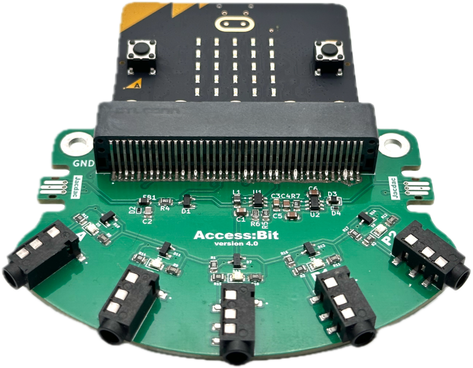
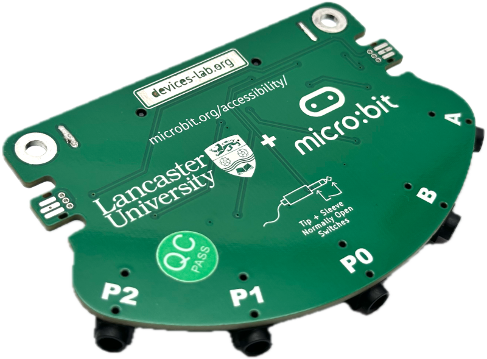
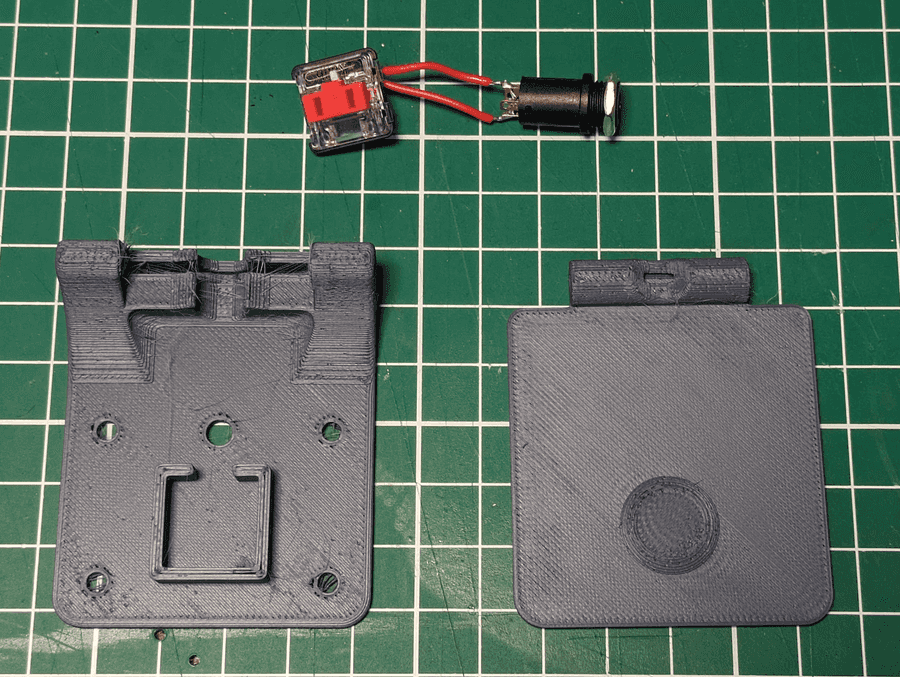
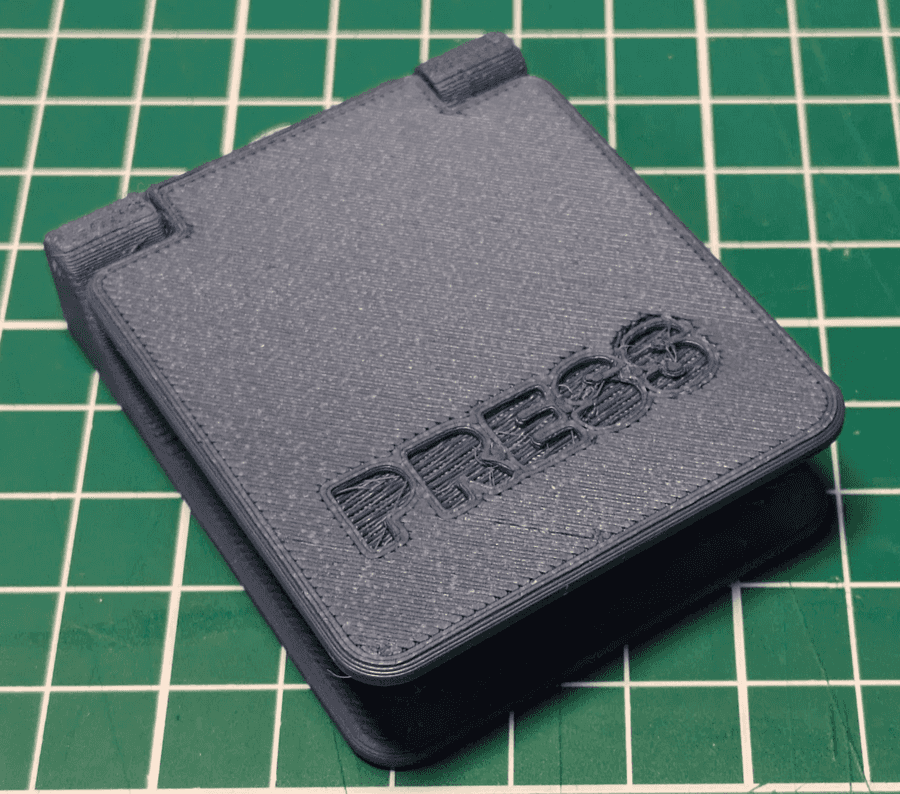
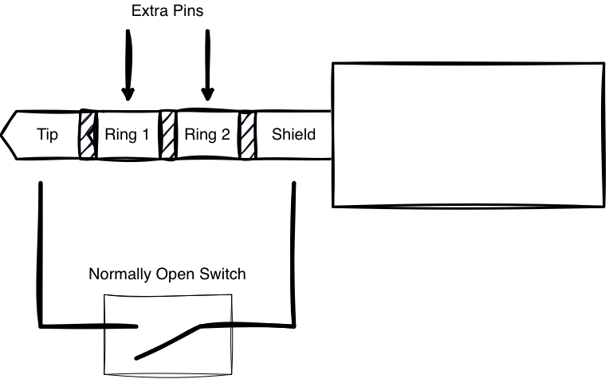

The Jaccess:Bit is a Micro:bit add-on board that lets you plug in accessibility switches, joysticks and other assistive controls directly, in place of fragile jumper wires and awkward hand-soldering.
It externalises the Micro:bit's `A` and `B` buttons out to a set of robust 3.5mm switch jacks, so a large external switch can stand in for a tiny onboard button.
This means anyone can take advantage of the huge range of Micro:bit teaching and training resources already out there, regardless of any mobility issues that might make the onboard buttons hard to use.

<x-shelf>
    <x-card>
        <x-photo></x-photo>
        <x-caption>The Jaccess:Bit with a Micro:bit fitted.</x-caption>
    </x-card>
    <x-card>
        <x-photo></x-photo>
        <x-caption>The rear of the board, showing the edge connector.</x-caption>
    </x-card>
</x-shelf>

We include two large mounting holes at the top of the board, if users want to bolt, screw, or zip-tie the board in place for an even more secure setup. While we can't guarantee that the board will work with _all_ possible switches and inputs, it should work with a large proportion of the generally available ones on the market, provided that they switch on the Tip and Shield connections.

<x-shelf>
    <x-card>
        <x-photo></x-photo>
        <x-caption>Before assembly</x-caption>
    </x-card>
    <x-card>
        <x-photo></x-photo>
        <x-caption>After assembly</x-caption>
    </x-card>
</x-shelf>

If you also need basic switches and have access to a 3d printer, John has also made his designs for [some basic large-format paddle switches](https://johnvidler.co.uk/blog/3d-printable-accessibility-switches/) using readily available keyboard switches and cheap barrel jack sockets available for free, and these can be assembled on mass with minimal soldering and assembly.

## Jacdac ports

Alongside the switch jacks, the Jaccess:Bit includes two powered Jacdac ports, so you can connect further inputs and outputs without a tangle of jumper wires.
This is especially useful in environments where fine motor control may be a challenge — a single robust, keyed cable is much easier to manage than several loose wires.

Each port also has its own LED. With no device connected, this LED simply reflects the state of that port's pin, giving you an at-a-glance indicator without needing anything plugged in at all.

## Advanced: Extra pins on the barrel jacks

For more experienced users, jumpers on the back of the board can be soldered to expose four extra pins over the 3.5mm barrel jack connections. This lets you interface with more complex devices that need more than a simple switch closure, while keeping the same easy-to-plug-in connectors.

<x-shelf>
    <x-card>
        <x-photo></x-photo>
        <x-caption>The board only uses the Tip and Shield (TS) pins by default, but can enable the other two pins on port A and B</x-caption>
    </x-card>
</x-shelf>
